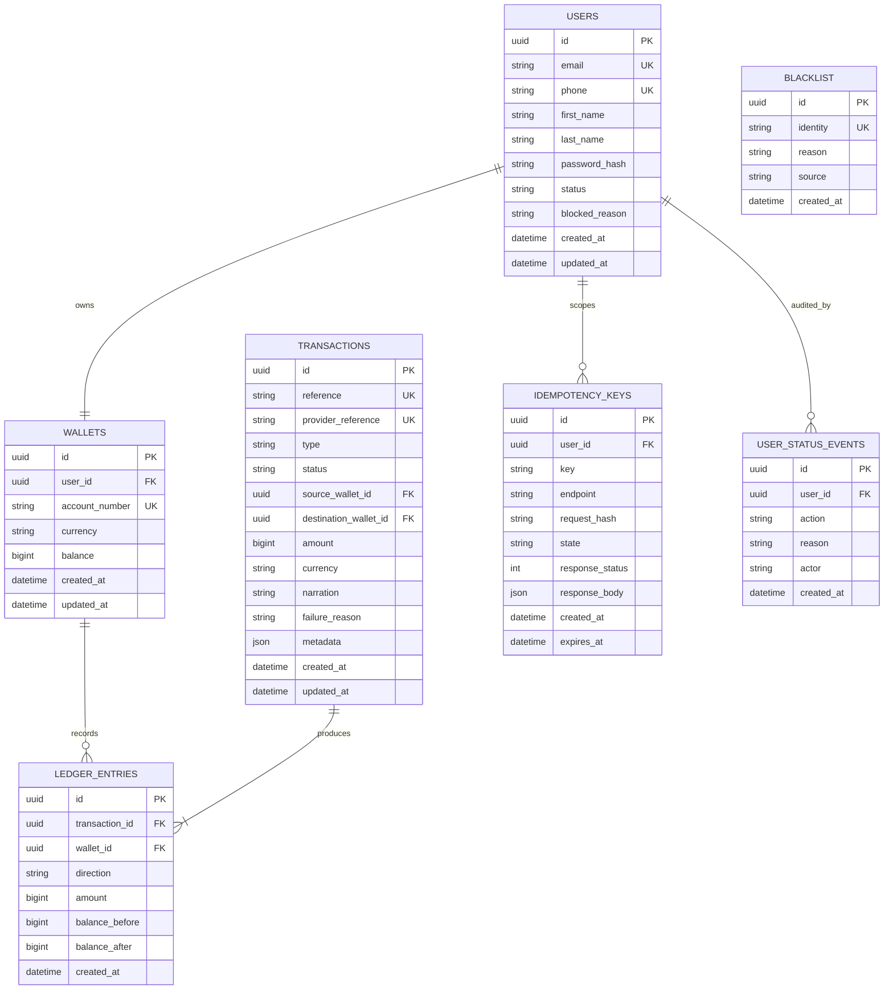

# Lendsqr Wallet & Double-Entry Ledger Service (`lendsqr-be-test`)

Production-grade wallet and money transfer service built for the **Lendsqr Full-Stack / DevOps Engineer Assessment** by **Winner OrluVictor**.

- **Live Deployment (Render)**: [`https://winner-orluvictor-lendsqr-be-test.onrender.com`](https://winner-orluvictor-lendsqr-be-test.onrender.com)
- **Interactive Swagger UI**: [`https://winner-orluvictor-lendsqr-be-test.onrender.com/docs`](https://winner-orluvictor-lendsqr-be-test.onrender.com/docs)
- **Health & DB Readiness**: [`https://winner-orluvictor-lendsqr-be-test.onrender.com/health`](https://winner-orluvictor-lendsqr-be-test.onrender.com/health)

---

## 1. Overview & Features

At Lendsqr's scale, every disbursement, deposit, and wallet-to-wallet transfer must be **accurate, atomic, idempotent, and safe under high concurrency**. This service implements:

1. **Account Onboarding & Automatic Wallet Provisioning (`POST /v1/auth/register`)**:
   - Screens users against both a local PostgreSQL `blacklist` table and the **Lendsqr Adjutor Karma API** (`GET /v2/verification/karma/:identity`, scope: `Karma Lookup`) across email and phone number.
   - Atomically creates the user and their NGN wallet (with a unique 10-digit NUBAN-style account number) inside a single database transaction.
2. **Wallet Funding (`POST /v1/wallets/fund`, `GET /v1/wallets/fund/verify/:reference`, `POST /v1/webhooks/paystack`)**:
   - Supports **Paystack Test Mode** (`transaction/initialize`, `transaction/verify/:reference`, and HMAC-SHA512 verified `charge.success` webhooks) as well as **instant simulated funding** (`mode: "simulated"`) so reviewers and automated test suites can fund wallets immediately without external keys.
   - Guarantees **single-credit safety**: even if Paystack's webhook and the verify endpoint fire simultaneously, `SELECT ... FOR UPDATE` on the pending transaction row ensures the wallet is credited exactly once.
3. **Atomic Row-Locked Wallet Transfers (`POST /v1/transfers`)**:
   - Transfers funds from Wallet A to Wallet B by recipient **email**, **10-digit account number**, or **wallet UUID**.
   - Uses pessimistic row-level locking (`SELECT ... FOR UPDATE`) with **deterministic lock ordering** (`ORDER BY id ASC`) to prevent race conditions and circular-wait deadlocks.
4. **Double-Entry Ledger & Integer Minor Units (Kobo)**:
   - All money is stored and processed as `BIGINT` minor units (**kobo**: `₦1,000.00` = `100000`). Floating-point math is never used.
   - Every balance change writes balanced `debit` and `credit` records to `ledger_entries` with `balance_before` and `balance_after` snapshots. `GET /v1/wallets/me` continuously reconciles the wallet balance against the sum of its ledger entries.
5. **Idempotency & Replay Protection (`Idempotency-Key` Header)**:
   - Required on `POST /v1/transfers` and `POST /v1/wallets/fund`.
   - Hashes `(HTTP method + endpoint + canonical JSON payload)` with SHA-256:
     - Replaying the same key + same payload returns the stored receipt with `X-Idempotent-Replay: true` without moving money twice.
     - Reusing the same key with a different payload returns `422 IDEMPOTENCY_KEY_REUSED`.
     - Concurrent duplicate requests while the first is in flight return `409 REQUEST_IN_PROGRESS`.
6. **Audited User Management & Blacklist Controls (`/v1/admin/*`)**:
   - Admins (`x-admin-key`) can block or unblock accounts with a mandatory reason recorded in `user_status_events`, and add/remove identities in the local `blacklist`.

---

## 2. Database Design & Entity-Relationship Diagram (ERD)



### Database-Level Constraints (Defense in Depth)
- `wallets.balance`: `CHECK (balance >= 0)` — Postgres rejects any write that would push a wallet negative even if application validation were bypassed.
- `transactions.amount` & `ledger_entries.amount`: `CHECK (amount > 0)`.
- `transactions`: `CHECK (source_wallet_id <> destination_wallet_id)` — prevents self-transfers at the storage engine level.
- `idempotency_keys`: `UNIQUE (user_id, key)` — atomic lock acquisition for concurrent duplicate requests.

---

## 3. Architectural & Gap Decisions

The assessment brief notes that *"some requirements are deliberately not spelled out."* Below are the engineering decisions made to close those gaps:

| Unspecified Gap | Engineering Decision & Rationale |
|---|---|
| **How do funds enter a wallet before a transfer?** | Built `POST /v1/wallets/fund` supporting both **Paystack Test Mode** (checkout URL + HMAC webhook + verify fallback) and **simulated instant funding** (`mode: "simulated"`). This provides real fintech integration while allowing one-click testing without external keys. |
| **Can a blocked user receive transfers?** | **No.** A blocked account (`status = 'blocked'`) is frozen in both directions: it cannot log in, fund, send (`403 USER_BLOCKED`), or receive funds (`403 RECIPIENT_BLOCKED`). |
| **How is the blacklist sourced and cached?** | Hybrid strategy: checks the local `blacklist` table first (O(1) indexed query), then queries Lendsqr's **Adjutor Karma API** (`GET /v2/verification/karma/:identity`). Any Karma hit is cached locally with `source = 'karma'` to save API credits on repeat attempts. |
| **How are deadlocks prevented during bidirectional transfers?** | When User A transfers to User B while User B simultaneously transfers to User A, locking sender-then-recipient would deadlock. We sort `[walletA.id, walletB.id]` lexicographically and execute `SELECT * FROM wallets WHERE id IN (?, ?) ORDER BY id ASC FOR UPDATE`. |
| **Why Express + Knex instead of heavy ORM decorators?** | Explicit SQL transaction boundaries (`db.transaction(trx => ... .forUpdate())`) make concurrency locks transparent, audit-friendly, and fast to extend live during Stage 2. |

---

## 4. Quick Start & Local Setup

### Prerequisites
- **Node.js** 20+ (tested on Node 22 & 24 LTS)
- **PostgreSQL** 15+ (or Docker Compose). *Note: Automated tests also include an in-memory PostgreSQL fallback (`pg-mem`) so `npm test` runs anywhere with zero setup.*

### 1. Clone & Install
```bash
git clone https://github.com/winnerdebest/lendsqr-be-test.git
cd lendsqr-be-test
npm install
```

### 2. Configure Environment
```bash
cp .env.example .env
```
Edit `.env` with your PostgreSQL connection string (`DATABASE_URL`) and optional `ADJUTOR_API_KEY` / `PAYSTACK_SECRET_KEY`.

### 3. Run Migrations & Start Server
```bash
# Start local Postgres via Docker (optional if local Postgres is already running)
docker compose up -d postgres

# Apply database schema migrations
npm run migrate:latest

# Start development server with hot reload
npm run dev
```
Open `http://localhost:3000` for the Lendsqr-branded service dashboard, or `http://localhost:3000/docs` for the interactive Swagger UI.

---

## 5. Running the Test Suite

```bash
# Run all unit, integration, idempotency, and concurrency tests
npm test

# Run only unit tests
npm run test:unit

# Run only integration & parallel concurrency tests
npm run test:integration

# Run with coverage report
npm run test:coverage
```

What the test suite verifies:
- **Unit tests (`tests/unit/`)**: Positive and negative cases for `BlacklistService`, `KarmaClient`, `AuthService`, `WalletsService`, `PaystackClient`, `AdminService`, and `TransfersService` (insufficient funds, self-transfer, blocked sender/recipient, invalid amounts, duplicate users, Karma 404 vs 200 vs 503 fail-closed).
- **Concurrency & Idempotency integration tests (`tests/integration/api.concurrency.test.ts`)**:
  - 10 parallel transfers firing simultaneously against a single funded wallet (proves no double-spend and exact zero ending balance).
  - Simultaneous bidirectional `A -> B` and `B -> A` transfers (proves zero deadlocks and exact conservation of funds).
  - Idempotency key replay (`X-Idempotent-Replay: true`) and payload mutation rejection (`422 IDEMPOTENCY_KEY_REUSED`).

---

## 6. Deployment on Render

This repository includes a [`render.yaml`](./render.yaml) Blueprint and multi-stage [`Dockerfile`](./Dockerfile):
1. Push repository to GitHub (`https://github.com/winnerdebest/lendsqr-be-test`).
2. In Render Dashboard, click **New +** &rarr; **Blueprint** (or **Web Service**) and connect the repository.
3. Name the service `winner-orluvictor-lendsqr-be-test` so it deploys to `https://winner-orluvictor-lendsqr-be-test.onrender.com`.
4. Set `ADJUTOR_API_KEY` and `PAYSTACK_SECRET_KEY` in the Render Environment tab. Startup migrations run automatically on boot.
